<div align="center">

# Parcial 2 — Misiones


**Carlos Andrés Orozco Caicedo** · Desarrollo de Software para Plataformas Móviles · UAO

</div>

---

App en Ionic + React donde usuarios reales (Firebase Auth) desbloquean y completan misiones que usan sensores del celular, ganan puntos y compiten en un ranking en vivo.

## Misiones

| # | Misión | Lógica real | Puntos |
|---|---|---|---|
| 01 | **Evidencia** | Abre la cámara (`@capacitor/camera`). Se completa al **guardar** la imagen. | 50 |
| 02 | **Movimiento real** | Guarda la posición original y escucha el GPS con `watchPosition`. Se completa cuando la distancia (Haversine) llega a **50 m** (cumple "moverse 50 metros" y "distancia > 30m") con una lectura de precisión ≤ 35 m. | 70 |
| 03 | **Permanencia activa** | Bloqueada hasta completar la 02. Escucha el acelerómetro (`@capacitor/motion`); si te mueves, el conteo se reinicia. A los **10 s quieto vibra** (`@capacitor/haptics`). No bloquea la pantalla y pide *Wake Lock* para que no se apague. | 80 |

Los umbrales (50 m, 35 m de precisión, 10 s) están en `src/missions.ts`.

## Requisitos del parcial

| Requisito | Implementación |
|---|---|
| Registro y login de usuarios reales | `hooks/useFirebaseAuth.ts` (`createUserWithEmailAndPassword`, `signInWithEmailAndPassword`) |
| Lista de misiones con estado y puntos | `pages/Misiones.tsx` + `components/MissionCard.tsx` (Pendiente / En curso / Bloqueada / Completada) |
| Sistema de puntos y total acumulado | `missions.ts` (`pointsFor`) + `components/ScoreHeader.tsx` |
| Barra de progreso (% y completadas / total) | `ScoreHeader.tsx` (`IonProgressBar`) |
| Persistencia en Firebase **y** local | `hooks/useProgress.ts` → `localStorage` + Firestore `users/{uid}` |
| API: enviar puntos a Firebase | `useProgress.ts` → `pushToFirebase()` (`setDoc` con `merge`) |
| Pantalla de resultados | `pages/Resultados.tsx` (puntos, misiones completadas, estado general) |
| Notificaciones locales | `hooks/useNotifications.ts` + `context/GameContext.tsx` → "Has completado una misión", "Te falta 1 misión para completar". El permiso se pide con el botón "Activar notificaciones" y el mismo mensaje se muestra también como aviso (`IonToast`) dentro de la app |
| Ranking top 5 con usuarios reales | `hooks/useRanking.ts` (`onSnapshot` en vivo). Si no estás en el top 5 se muestran los 4 primeros + **tu posición real** (`getCountFromServer`) |
| Hooks | `useFirebaseAuth`, `useProgress`, `useCamera`, `useDistanceTracker`, `useStillness`, `useNotifications`, `useRanking` |
| Manejo de estado | `useReducer` en `useProgress` + Context (`AuthContext`, `GameContext`) |

### Formato guardado (Firebase y localStorage)

```json
{
  "points": 120,
  "missions": [
    { "id": 1, "completed": true },
    { "id": 2, "completed": true },
    { "id": 3, "completed": false }
  ]
}
```

En Firestore el documento `users/{uid}` además lleva `name`, `email`, `updatedAt` y una miniatura de la foto de evidencia. En `localStorage` se usa la clave `parcial2:progress:{uid}` (por usuario).

Al entrar se carga primero lo local (instantáneo) y luego Firebase; se unen ambos (una misión completada en cualquiera de los dos cuenta) y se sincroniza. Si no hay internet todo sigue funcionando y se sube después.

## Configurar Firebase

1. [Firebase Console](https://console.firebase.google.com) → proyecto → **Authentication → Sign-in method → Email/Password: activar**.
2. **Firestore Database → Crear base de datos** (modo producción).
3. **Firestore → Reglas**: pega el contenido de `firestore.rules` y publica (cualquier usuario logueado lee el ranking; cada uno solo escribe su documento).
4. **Configuración del proyecto → Tus apps → Web**: copia la config a `.env` (plantilla en `.env.example`).

## Cómo correrla

```bash
npm install
npm run dev
```

En el navegador funcionan la cámara (`@ionic/pwa-elements`), el GPS y las notificaciones. El acelerómetro y la vibración necesitan un celular.

### Android

```bash
npm run build
npx cap sync android
npx cap open android
```

Los permisos (cámara, ubicación, vibración, notificaciones) ya están en `android/app/src/main/AndroidManifest.xml`.

### Probar en el celular sin instalar

```bash
npm run dev
cloudflared tunnel --url http://localhost:5173
```

Abre la URL `https://xxxx.trycloudflare.com` en el celular (los sensores del navegador exigen HTTPS).

## Estructura

```text
firestore.rules                → reglas de seguridad de Firestore
src/
├── missions.ts                → catálogo de misiones, umbrales y cálculo de puntos
├── lib/ firebase  storage  geo  image  wakeLock
├── hooks/
│   ├── useFirebaseAuth.ts     → sesión, login, registro, logout
│   ├── useProgress.ts         → useReducer + localStorage + Firestore
│   ├── useCamera.ts           → Misión 1
│   ├── useDistanceTracker.ts  → Misión 2 (Geolocation.watchPosition)
│   ├── useStillness.ts        → Misión 3 (Motion + Haptics)
│   ├── useNotifications.ts    → LocalNotifications
│   └── useRanking.ts          → top 5 en vivo
├── context/ AuthContext  GameContext
├── components/ MissionCard  ScoreHeader  TabBar  AuthForm  PrivateRoute …
└── pages/ Login  Register  Misiones  Ranking  Resultados
```

## Capturas

| Login | Registro | Misiones (inicio) |
|---|---|---|
| 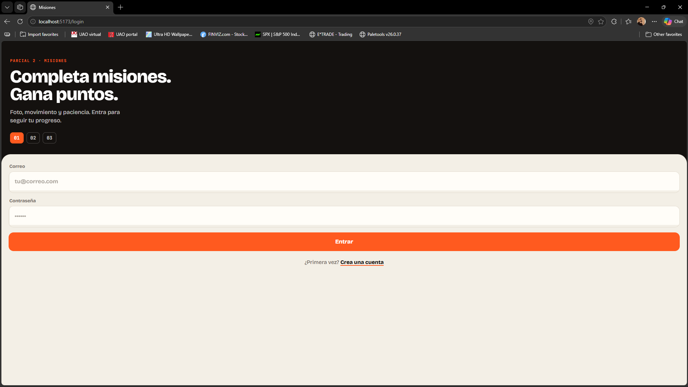 | 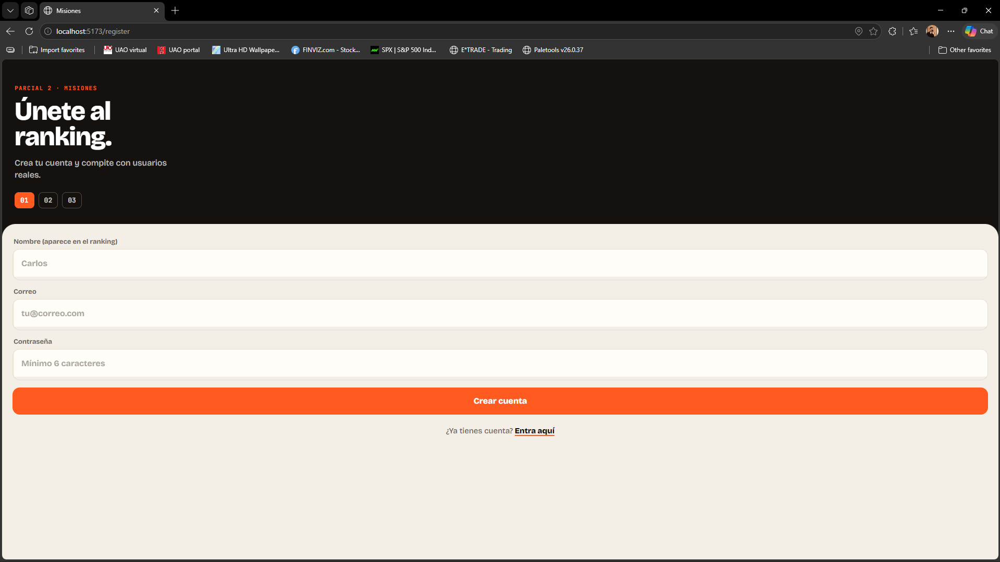 | 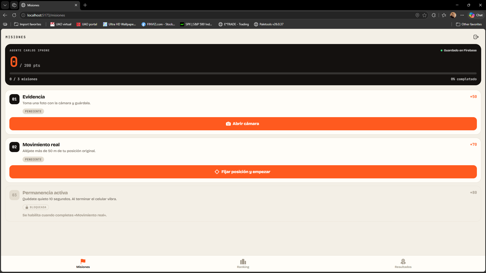 |

| Misión 1 · Evidencia | Misión 2 · Movimiento | Misión 3 · Permanencia |
|---|---|---|
| 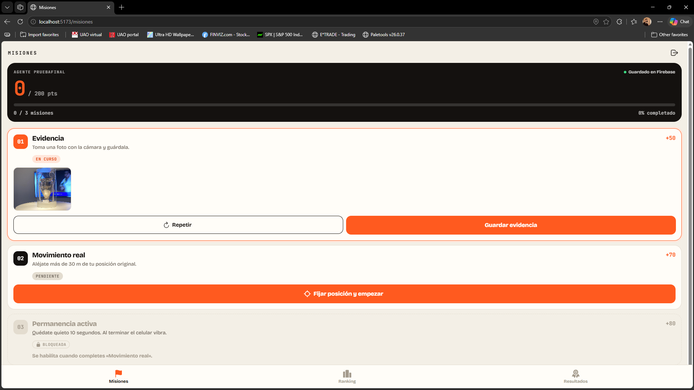 | 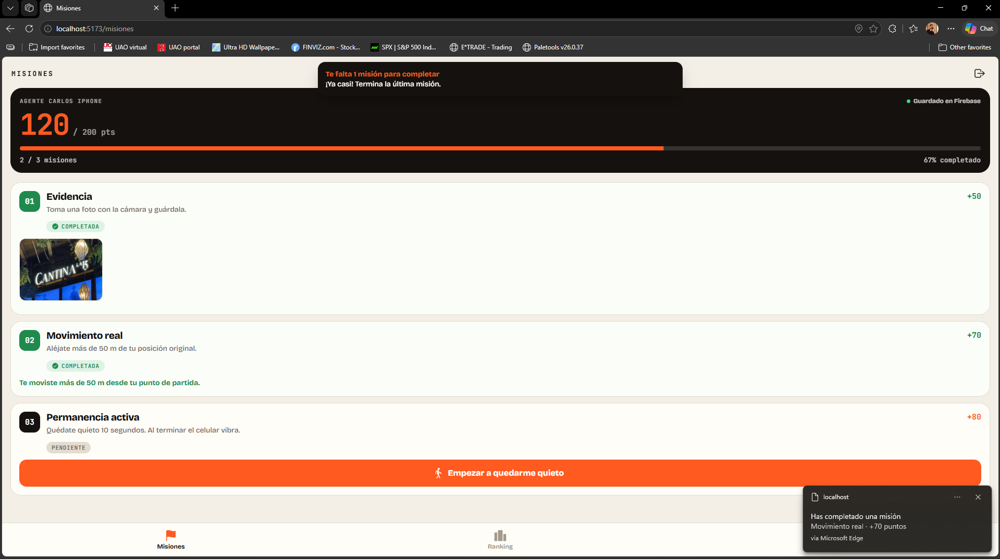 | 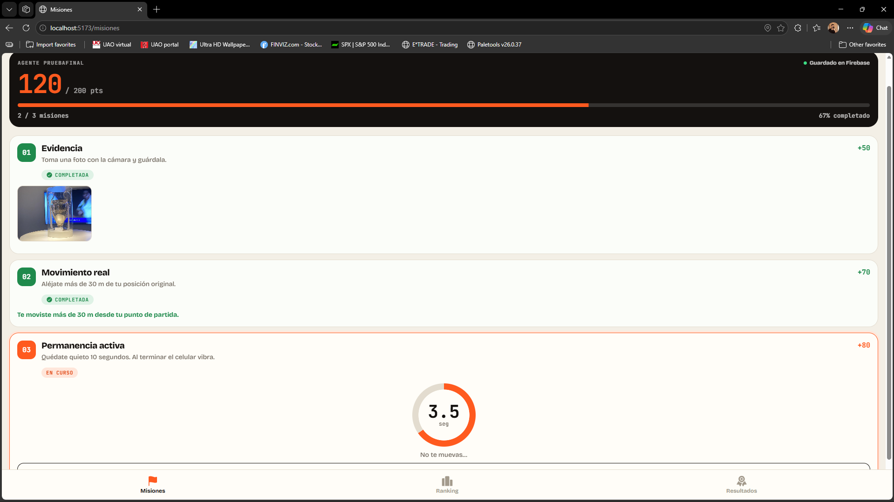 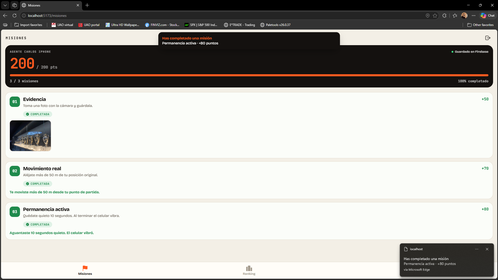 |

| Misiones completas | Notificación | Ranking |
|---|---|---|
| 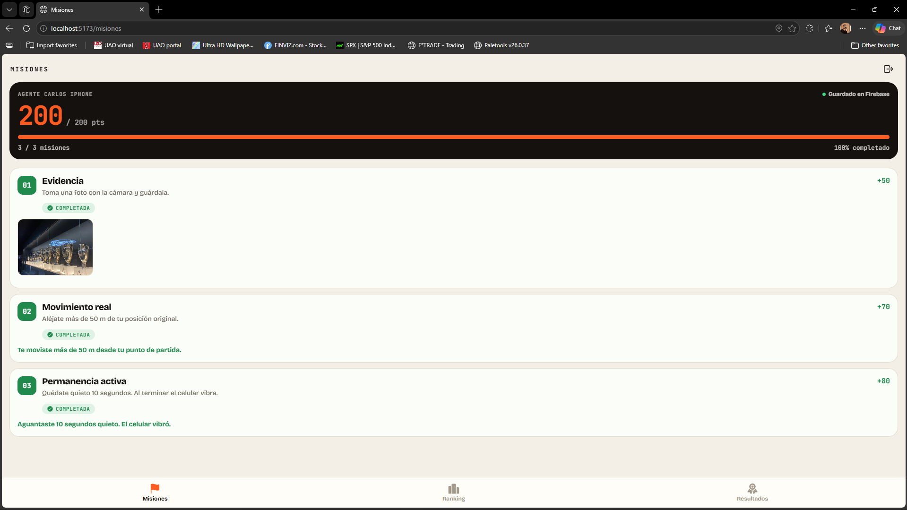 | 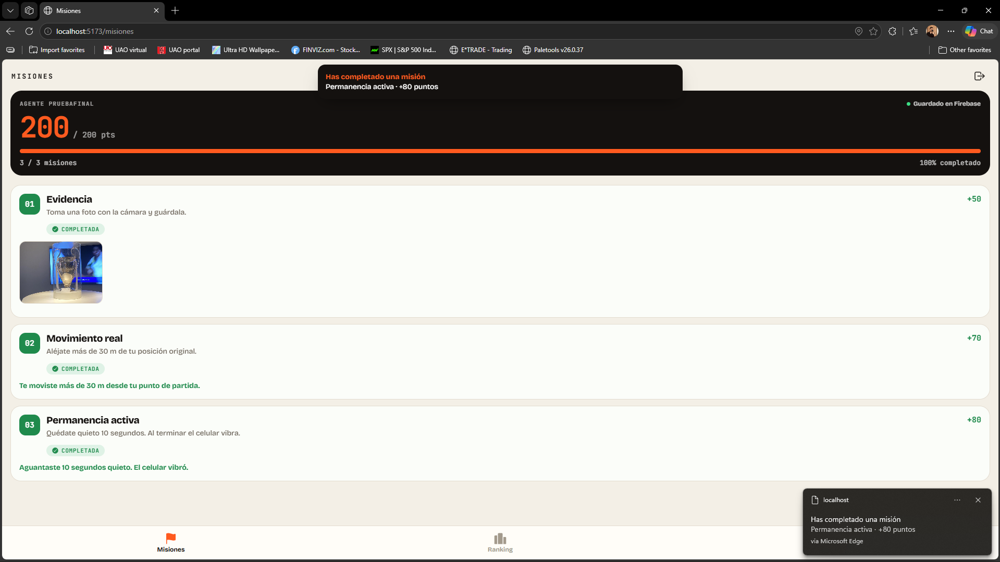 | 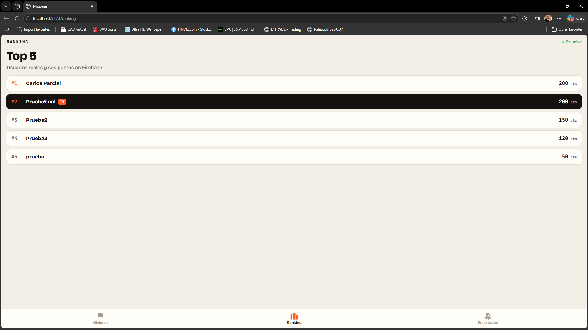 |

| Resultados | Firestore |
|---|---|
| 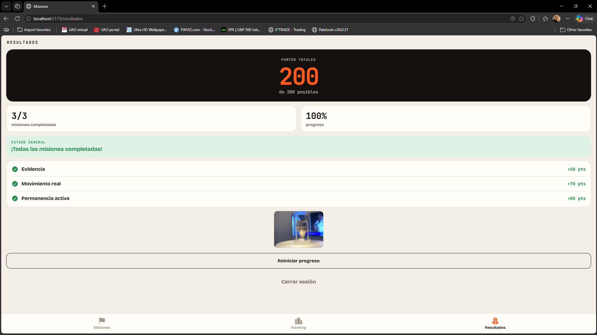 | 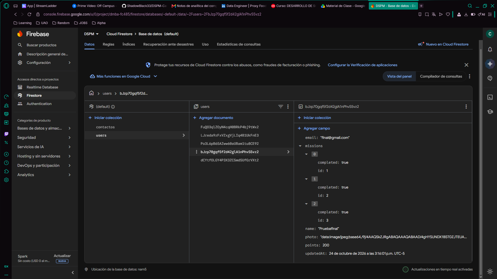 |

### Prueba en iPhone (Safari, por túnel de Cloudflare)

| Cámara | Permiso de ubicación | Acelerómetro detecta movimiento |
|---|---|---|
| 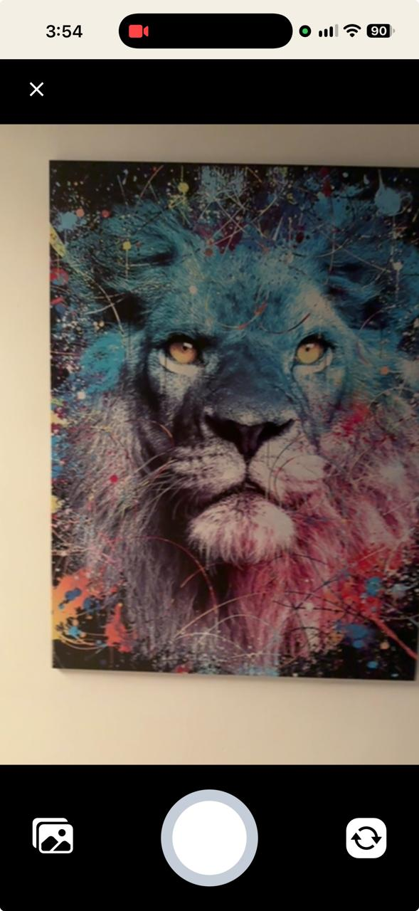 | 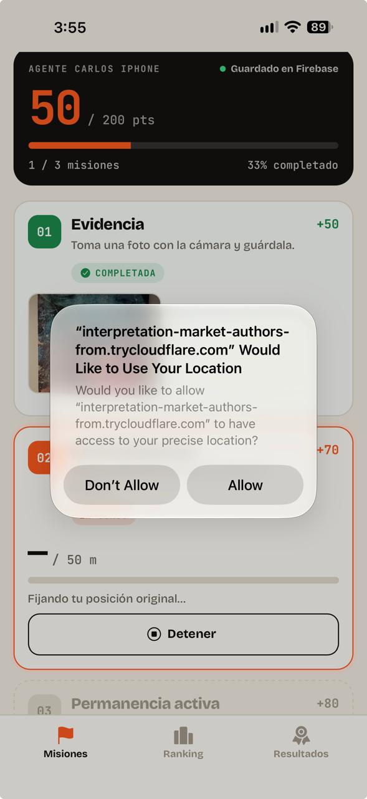 | 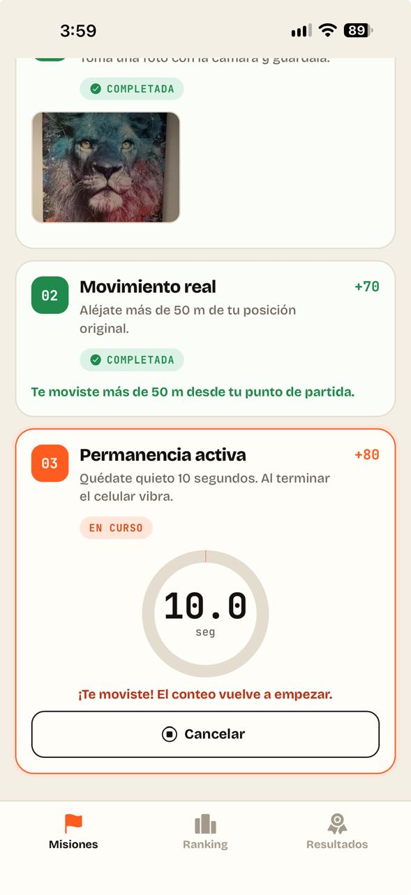 |

| Misiones completas | Notificaciones del sistema |
|---|---|
| 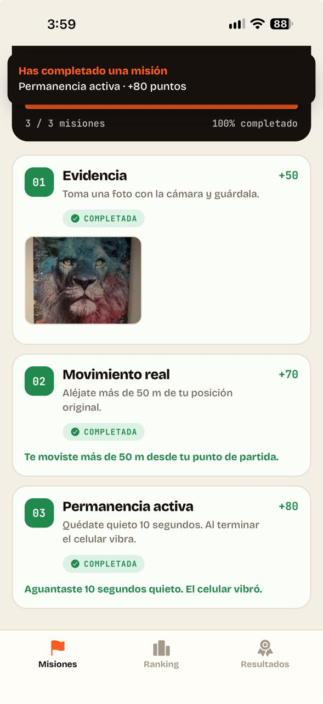 | 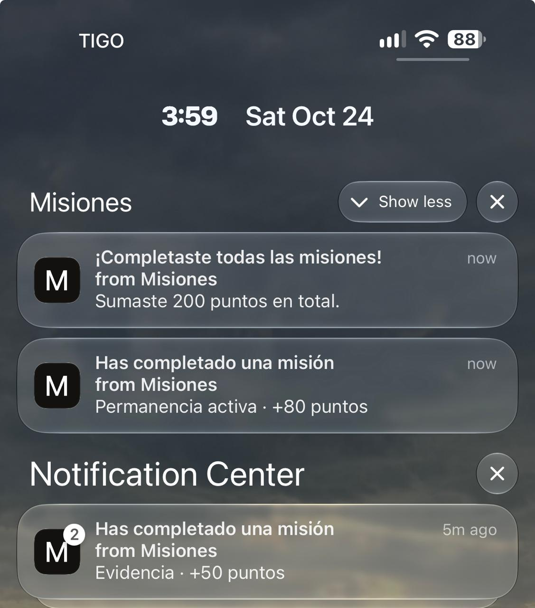 |

> **Nota sobre la vibración en iPhone:** Safari no implementa la API de vibración (restricción de Apple), así que desde el navegador del iPhone la Misión 3 se completa sin vibrar. En la app nativa (`@capacitor/haptics`) y en Chrome de Android sí vibra. Las notificaciones web en iPhone funcionan con la app agregada a la pantalla de inicio (`manifest.json` + service worker `public/sw.js`).

